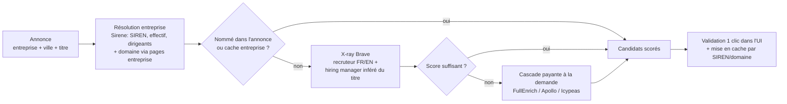

# Identifier les interlocuteurs recrutement des annonces — sans (ou avant) Apollo

> Analyse réalisée le 21 octobre 2026. Objectif à terme : depuis une annonce JobScraper,
> retrouver le ou les profils LinkedIn des personnes qui recrutent réellement pour ce poste.

---

## TL;DR

1. **Apollo est moins cher qu'il n'y paraît si on l'utilise bien** — la recherche de personnes est
   gratuite (0 crédit), seule la levée du masque (dont l'URL LinkedIn) coûte ~1 crédit, facturé
   uniquement si des données sont trouvées ([1](https://docs.apollo.io/docs/api-pricing),
   [6](https://docs.apollo.io/reference/bulk-people-enrichment)). Mais il y a un prix plancher :
   l'abonnement par siège (Basic 49 $/mois en annuel, soit 588 $/an, 30 000 crédits/an ;
   le plan gratuit inclut l'accès API avec 75 crédits/mois)
   ([2](https://pipeline.zoominfo.com/sales/apollo-api-review)). Et sa couverture des PME
   françaises est le point faible connu de sa base très centrée US.
2. **Le plus rentable est une cascade** : (0) exploiter ce que vos scrapers jettent déjà,
   (1) identifier l'entreprise via l'open data, (2) chercher les profils LinkedIn
   **indexés par les moteurs de recherche** (quasi gratuit), (3) ne payer un fournisseur
   d'enrichissement qu'en cas d'échec, **une fois par entreprise** (cache), jamais par annonce.
3. Apollo devient alors un fournisseur *parmi d'autres* dans la cascade — interchangeable
   avec FullEnrich ou Icypeas, souvent moins chers à ce volume.

---

## 1. Qui cherche-t-on exactement ?

« Interlocuteur direct » recouvre en pratique **deux personas**, à chercher différemment :

| Persona | Rôle pour vous | Titres LinkedIn typiques (FR + EN) |
|---|---|---|
| **Recruteur / RH** | Porte d'entrée du processus, répond aux sollicitations | Talent Acquisition, Chargé(e) de recrutement, Recruteur/Recruiter, Responsable recrutement, RH / HRBP, Head of Talent |
| **Hiring manager** | Décideur du poste, souvent le futur N+1 | Dépend de l'annonce : poste dev → CTO, Engineering Manager, Lead Dev ; data → Head of Data, Lead Data ; produit → CPO, Head of Product… |

Un interlocuteur est **« identifié »** quand on a : nom complet, titre **actuel** mentionnant
l'entreprise, et URL `linkedin.com/in/...`. C'est ce taux d'identification *validée* (et son coût unitaire)
qu'il faudra mesurer pour comparer les solutions (voir §7).

La **taille de l'entreprise** change la stratégie : dans une PME de 15 personnes, c'est souvent
le dirigeant ou le manager qui recrute (il n'y a pas de fonction RH dédiée) ; au-delà de ~250 salariés,
cherchez d'abord la fonction Talent Acquisition. L'effectif est récupérable gratuitement (§2.2).

---

## 2. Les gisements, du gratuit vers le payant

### 2.0 Ce que vos scrapers voient déjà… et jettent (0 €, à corriger en premier)

C'est le gisement le plus rentable : l'information passe sous les yeux du code actuel puis est perdue,
faute de champs dans `JobOffer` (`company_url`, `company_domain`, `company_linkedin_url`, `poster_name`) :

- **LinkedIn** : le nom d'entreprise des cartes et de la page d'annonce est un `<a>` vers
  `linkedin.com/company/...` (`a.topcard__org-name-link` dans `_parse_job_details` ; le code ne lit que
  `.get_text()`). Cette URL est un pont en or : page entreprise → site web officiel + onglet « Personnes ».
  La page d'annonce affiche aussi parfois l'auteur de l'offre (section *hiring team*, plutôt visible connecté).
- **WTTJ** : le hit Algolia contient l'objet `organization` complet (le code n'utilise que `name` et `slug`).
  La page entreprise WTTJ expose le site officiel et souvent le LinkedIn de l'entreprise —
  à collecter **une fois par entreprise**, puis mettre en cache.
- **HelloWork** : la page de détail contient l'organisation (`[itemprop='hiringOrganization']`) et,
  pour les cabinets/agences, l'identité du recruteur publiant.
- **France Travail** : via l'API officielle (recommandée dès l'analyse web), le champ `contact`
  d'une offre contient souvent un nom d'interlocuteur.
- **Adzuna** : pas d'interlocuteur, mais `redirect_url` mène à l'offre d'origine (souvent plus riche).

Rendement attendu : faible en volume, **précision maximale** — quelqu'un nommé dans l'annonce
est par définition le bon interlocuteur.

### 2.1 Identifier l'entreprise gratuitement (prérequis de tout le reste)

Tous les fournisseurs (Apollo compris) travaillent à partir d'un **domaine** d'entreprise fiable,
pas d'un nom approximatif (« Cap », « Groupe X SAS »…). En France, on a un atout :

- **`recherche-entreprises.api.gouv.fr`** : API officielle, ouverte, **sans clé**, 7 appels/s
  ([2](https://www.data.gouv.fr/dataservices/api-recherche-dentreprises)). À partir du nom
  (dédupliqué avec la ville de l'annonce), elle renvoie SIREN, effectif… et la liste des
  **dirigeants** (nom, prénoms, qualité) issue du RNE/INPI ([3](https://getregdata.com/skills/france-company-lookup/)).
  Pour les **petites structures, le dirigeant est souvent l'interlocuteur final**.
- Le domaine se déduit ensuite de la page entreprise LinkedIn/WTTJ (§2.0) ou par une recherche web
  du nom + ville, avec validation (le site mentionne la bonne raison sociale/ville).
- **Cache par entreprise** (SIREN comme clé) : une entreprise qui publie 30 annonces n'est résolue qu'une fois.
  C'est *ce* levier, plus que le choix du fournisseur, qui divise les coûts.

### 2.2 La recherche « X-ray » sur moteurs (quasi gratuit, le meilleur rapport coût/résultat)

Les profils LinkedIn publics sont indexés par Google/Brave. On les retrouve sans jamais scraper LinkedIn :

```
site:linkedin.com/in/ "Nom Entreprise" ("talent acquisition" OR recruteur OR "chargé de recrutement" OR "responsable recrutement" OR RH)
site:linkedin.com/in/ "Nom Entreprise" ("engineering manager" OR CTO OR "lead développeur") ville
```

- **Brave Search API** : 5 $ pour 1 000 requêtes, avec **5 $ de crédit offert chaque mois**,
  soit ~1 000 requêtes gratuites/mois ([1](https://api-dashboard.search.brave.com/documentation/pricing),
  [5](https://keirolabs.cloud/blog/brave-search-api-guide-2026)) — à ~4 requêtes par entreprise
  (recruteur FR/EN + manager), cela couvre ~250 entreprises/mois à 0 €, puis ~0,02 $/entreprise.
  Alternatives : Google Programmable Search, SerpApi, Tavily/Exa.
- **Scoring indispensable** des résultats : l'entreprise et un mot-clé de rôle dans le titre/snippet (+2 chacun),
  ville/région cohérente (+1), profil `/in/` (pas `/company/` ni `/jobs/`), ancien employeur écarté si le snippet
  dit « ex- » ou « anciennement ». On présente le top 3–5 avec score — en usage personnel,
  un clic humain valide en 5 secondes, ce qui rend la méthode *plus fiable* qu'une base Apollo jamais vérifiée.
- Limites : profils non indexés invisibles, homonymies d'entreprises (d'où le §2.1), et les CGU Brave
  restreignent le stockage durable des résultats ([7](https://katteb.com/blog/brave-search-ai-agent/)) :
  on conserve l'URL/identité validée, pas les snippets en masse.

### 2.3 Les cascades « payé seulement si trouvé » (le remplaçant économique d'Apollo)

Quand le gratuit échoue, au lieu d'un abonnement par siège, des acteurs facturent **au résultat** :

- **FullEnrich** (français) : cascade sur 25+ sources, on ne paie que la donnée trouvée —
  e-mail pro 1 crédit, données de profil/entreprise 0,25 crédit en demande seule
  ([1](https://syncgtm.com/blog/fullenrich-review)) ; entrée à 29 $/mois pour 500 crédits
  ([2](https://derrick-app.com/tools/fullenrich-review)), API incluse, essai 50 crédits.
- **Icypeas** (français) : à partir de 19 $/mois pour 1 000 crédits qui ne se perdent pas,
  facturé uniquement quand l'e-mail est trouvé ([2](https://syncgtm.com/blog/prospeo-alternatives)) ;
  le *domain scan* coûte 1 crédit ([6](https://orbisearch.com/compare/icypeas)).
  Idéal en **étape finale** : une fois nom + domaine connus (X-ray), retrouver/vérifier l'e-mail pro.
- Le principe « waterfall » (plusieurs bases interrogées en cascade jusqu'à succès) donne en général
  un meilleur taux de couverture Europe qu'une base unique.

### 2.4 Apollo, mais optimisé (si vous y tenez)

Le flux à bas coût, d'après la documentation officielle :

1. **People API Search (0 crédit)** filtrée par entreprise/domaine + `person_titles`
   (recrutement/RH ± hiring manager) : elle renvoie prénom, **nom masqué**, titre, sans URL LinkedIn
   ([1](https://docs.apollo.io/reference/people-api-search)).
2. **Enrichment sur les seuls 1–3 meilleurs IDs** ([2](https://docs.apollo.io/docs/retrieve-linkedin-profiles-for-prospects)) :
   ~1 crédit par personne si une donnée tombe (URL LinkedIn incluse), 0 sinon. N'activez jamais
   le *waterfall téléphone* (+8 crédits) — inutile pour votre objectif.

Soit ~1 crédit ≈ quelques centimes par interlocuteur. Le vrai coût est l'**abonnement siège**
(588 $/an en Basic) alors que vous consommerez peut-être 200 crédits/mois. Le plan gratuit
(75 crédits/mois) suffit à **mesurer** la couverture Apollo sur vos annonces avant tout engagement.

### 2.5 Sales Navigator & automatisations de compte (à manier avec prudence)

Un abonnement LinkedIn Recruiter/Sales Navigator + un outil d'extraction (Evaboot,
PhantomBuster, Waalaxy, Unipile…) donne d'excellents résultats en ciblage manuel
(entreprise → employés → fonction). Mais l'automatisation d'un compte LinkedIn viole les CGU
de LinkedIn et expose le compte à restriction/bannissement. À réserver, au mieux,
à un usage **manuel et ciblé** sur les entreprises prioritaires — pas à un pipeline automatique.

---

## 3. Comparatif synthétique

| Approche | Coût d'entrée | Coût / interlocuteur identifié* | Couverture FR probable | Effort d'intégration | Risque |
|---|---|---|---|---|---|
| Extraction à la source (§2.0) | 0 € | 0 € | Faible volume, précision ++++ | 0,5–1 j | — |
| Dirigeants Sirene (§2.1) | 0 € | 0 € | PME/TPE FR ++++ | 0,5 j | — |
| X-ray Brave (§2.2) | 0 € (≈1 000 req/mois offertes) | ~0–0,03 $ | Bonne si profils indexés, à valider par scoring | 1–2 j | CGU moteur (stockage) |
| FullEnrich / Icypeas (§2.3) | 19–29 $/mois | ~0,02–0,06 $ (payé si trouvé) | Bonne (cascade multi-sources, acteurs FR) | 0,5–1 j par fournisseur | Dépendance fournisseur |
| Apollo optimisé (§2.4) | 0 $ (test) puis 588 $/an | ~1 crédit (≈0,02 $ au tarif annuel) | Moyenne sur PME FR, forte sur scale-ups/ETI | 1 j | Prix siège sous-utilisé |
| Sales Nav + extraction (§2.5) | ~80–100 €/mois de licences | Temps humain | Excellente | Manuel | ⚠️ CGU LinkedIn, compte |

\* Ordres de grandeur issus des grilles publiques citées ; le coût *réel* dépend de votre taux de réussite (§5).

---

## 4. Architecture cible dans JobScraper

Réutiliser le patron existant (registry de scrapers → registry de *providers* de contacts) :



- **Modèles** : `CompanyIdentity` (nom, domaine, siren, url LinkedIn entreprise, effectif) et
  `ContactCandidate` (nom, titre, `linkedin_url`, type recruteur/manager/dirigeant,
  `found_via`, score de confiance, e-mail pro éventuel) — Pydantic, comme le reste.
- **Providers enfichables** `jobscraper/contacts/` : `PostingSourceProvider`, `SireneProvider`,
  `XrayProvider` (Brave), `FullEnrichProvider`, `ApolloProvider` — même interface, activés par
  présence de clé dans `.env` (pattern déjà utilisé pour Adzuna), chaînés en cascade par coût croissant.
- **À la demande, jamais en masse** : endpoint `POST /api/contacts/find` déclenché par un bouton
  « Interlocuteurs » sur chaque carte d'offre. Vous ne payez que pour les annonces qui vous intéressent,
  et le résultat est **caché par entreprise** (SIREN/domaine) — les 29 autres annonces de la même
  entreprise héritent du résultat gratuitement.
- **Garde-fous budget** : compteur de crédits par fournisseur, plafond mensuel configurable
  (`CONTACTS_MONTHLY_BUDGET_USD`), journalisation du coût par identification réussie.
- **Inférence du hiring manager** : table de correspondance titre de l'annonce → titres cibles
  (data/dev/produit/sales/ops…), modulée par l'effectif Sirene.

---

## 5. Protocole de mesure avant tout abonnement

Sur un échantillon de **30 annonces réelles récentes** (votre usage type) :

1. Phase gratuite (2.0 → 2.2) : mesurer le % d'annonces avec ≥1 interlocuteur validé manuellement.
2. Même échantillon chez Apollo gratuit (75 crédits) et FullEnrich essai (50 crédits).
3. Comparer **coût par interlocuteur validé** et taux de couverture — décider alors, chiffres en main.

C'est 1 à 2 heures de travail et cela évite 588 $/an engagés à l'aveugle.

---

## 6. Cadre légal et bonnes pratiques (Paris)

- **RGPD** : un profil LinkedIn public reste une donnée personnelle. En prospection B2B,
  la CNIL admet l'intérêt légitime pour des contacts professionnels pertinents, avec information,
  droit d'opposition et durée de conservation limitée. Restez sur des données **professionnelles
  publiques**, pas d'e-mails personnels, pas de revente ni de constitution de base massive.
- **CGU LinkedIn** : scraping et automatisation de compte interdits — l'approche « moteurs de recherche
  + clic humain » (§2.2) et les API de fournisseurs restent du bon côté de la ligne ;
  évitez les « API LinkedIn » grises qui ferment du jour au lendemain.
- **Finalité** : candidature ciblée, prise de contact commerciale ou veille — la méthode est la même,
  mais le message et la base légale diffèrent. L'outil identifie et présente ; l'humain contacte.

---

## 7. Roadmap recommandée

| Phase | Contenu | Coût data | Durée |
|---|---|---|---|
| **0** | Champs entreprise dans `JobOffer` (URL LinkedIn entreprise, domaine via pages WTTJ) + résolution Sirene (SIREN, effectif, dirigeants) + cache entreprise | 0 € | 1 j |
| **1** | Provider X-ray Brave + scoring + panneau « Interlocuteurs » dans l'UI (à la demande) | 0 € (crédit mensuel) | 1–2 j |
| **2** | Mesure sur 30 annonces (§5) : gratuit vs Apollo Free vs essai FullEnrich | 0 € | 2 h |
| **3** | Branchement du fournisseur payant gagnant en bout de cascade, avec plafond budget | dès 19–29 $/mois seulement si le gratuit ne suffit pas | 0,5–1 j |

---

## Annexe — Ce que permet gratuitement l'API Apollo (état au 21/10/2026)

Règle officielle : seuls les endpoints du tableau *API Pricing and Credits* consomment des
crédits ; **tous les autres endpoints sont à 0 crédit**
([source](https://docs.apollo.io/docs/api-pricing)). L'accès API est inclus dans tous les plans,
y compris Free, à condition d'un compte inscrit avec un **e-mail professionnel**
([source](https://knowledge.apollo.io/hc/en-us/articles/4416173158541-Use-Apollo-API)).

### A. 0 crédit (borné uniquement par les rate limits du plan Free)

Rate limits Free — **par équipe et par endpoint** : recherche et standard 50/min, 200/h, **600/jour** ;
enrichissement 50/min (20 bulk), 200/h (100 bulk), 600/jour
([source](https://docs.apollo.io/reference/rate-limits)).

- **People API Search** (`POST /api/v1/mixed_people/api_search`) — la pièce centrale : 0 crédit,
  100 résultats/page, plafond d'affichage 50 000 personnes. Filtres : `person_titles`
  (+ similaires, exclusions de titres actuels/passés), `person_seniorities` (owner → intern),
  `person_locations` / `organization_locations`, `q_keywords`, `q_person_name`, et côté entreprise :
  CA (`revenue_range`), technologies utilisées (1 500+), **titres des offres
  activement recrutées** (`q_organization_job_titles`), nombre d'offres actives, dates de publication,
  croissance d'effectif. Retourne : `total_entries`, id Apollo, prénom, **nom masqué**, titre actuel,
  indicateurs de disponibilité des données de l'employeur — **ni e-mail, ni téléphone, ni URL LinkedIn**
  ([source](https://docs.apollo.io/reference/people-api-search)).
- **Gestion des records** (vos données Apollo, tout à 0 crédit) : *Accounts* et *Contacts*
  (recherche, lecture, création, création en bulk, mise à jour, bulk update, changement de propriétaire/
  d'étape, listes des étapes), *Deals* (liste, lecture, création, mise à jour, étapes),
  *Lists* (lister, créer, mettre à jour, ajouter/retirer des records), *Notes* (lister).
- **Engagement** (0 crédit ; limites du plan Free par ailleurs) : *Sequences* (créer, mettre à jour,
  rechercher, activer/désactiver/archiver, ajouter des contacts, statuts, activité, plannings d'envoi),
  *Emails* (brouillon, envoi immédiat, statut, recherche d'e-mails d'outreach, contenu, statistiques),
  *Calls* (créer/chercher/mettre à jour des enregistrements d'appels),
  *Tasks* (chercher, lire, créer, bulk, compléter, mettre à jour, passer),
  *Conversations* sans AI insights (recherche, infos, export : 0 crédit si pas d'insights IA).
- **AI Assistant** : soumettre une tâche et la *poller* ne consomme rien ; seules les actions
  réalisées (ex. enrichissement) sont facturées selon l'action.
- **Workspace & pilotage** : liste des utilisateurs, profil courant, comptes e-mail, champs
  personnalisés (lister/créer/mettre à jour), rapport analytics (5 req/h),
  **consultation de votre consommation de crédits et de vos rate limits**, polling de webhooks.

### B. Payant au crédit — mais finançable par les 75 crédits/mois du plan Free

Le plan Free octroie **75 crédits/mois** (900/an versés mensuellement, pas d'un bloc), 1 siège,
sans possibilité d'acheter des crédits additionnels
([source](https://pipeline.zoominfo.com/sales/apollo-api-review),
[source](https://www.trexinet.com/blog/apollo-free-credits)).
Tarifs officiels par endpoint ([source](https://docs.apollo.io/docs/api-pricing)) et équivalent mensuel gratuit :

| Endpoint | Coût | Avec 75 crédits/mois |
|---|---|---|
| People enrichment / bulk (10 max/appel) | **1 crédit** si données démographiques/e-mail trouvées (URL LinkedIn incluse), **+8** si mobile renvoyé, **0 si rien trouvé** | ~75 personnes démasquées (sans téléphone) |
| Get complete person info | 1 crédit/personne | 75 profils |
| Organization enrichment / bulk ; Get complete organization info | 1 crédit/entreprise | 75 entreprises |
| Organization search | 1 crédit/page (≤100 résultats) | 75 pages ≈ métadonnées de 7 500 entreprises |
| Organization job postings | 1 crédit/page (≤10 000 résultats) | 75 pages d'offres d'une entreprise |
| News articles search | 1 crédit/page (≤25 articles) | 75 pages ≈ 1 875 articles |
| Conversations (avec AI insights) | 1 crédit/conversation | 75 conversations |

Optimisations : ne jamais demander la révélation du téléphone (+8 crédits) pour l'objectif
« URL LinkedIn » ; n'enrichir que les meilleurs IDs issus de la recherche gratuite ;
un échec de matching (`match_confidence: none`) ne coûte rien.

### C. Non inclus dans le gratuit

- URL LinkedIn, e-mail et téléphone **via la seule recherche** (enrichissement indispensable).
- **Waterfall enrichment** (cascade multi-fournisseurs) : absent du plan Free — et de toute façon
  typiquement 1–4 crédits/e-mail et 8–25/téléphone, parfois facturé même en échec selon les vendeurs.
- Crédits au-delà des 75/mois (pas d'achat d'add-ons en Free) ; limites applicatives du plan Free
  (séquences, boîte d'envoi unique, filtres « basiques » dans l'UI, plafond de sélection de 25 records).
- Endpoints de recherche/enrichissement avec un compte inscrit via e-mail personnel (bloqués).

### D. Traduction concrète pour JobScraper (0 €/mois)

1. Par entreprise d'une annonce : **People Search gratuite** filtrée par domaine/nom +
   titres recrutement et hiring manager → vous savez gratuitement *combien* d'interlocuteurs
   potentiels existent et leurs titres (prénom + initiale).
2. **Enrichir uniquement le top 1–2** : 1–2 crédits/entreprise → **37 à 75 entreprises par mois**
   entièrement identifiées (nom complet + URL LinkedIn), résultat caché par entreprise.
3. Les contacts validés peuvent être **stockés gratuitement dans Apollo** (création de contacts
   à 0 crédit) ou, mieux, dans votre propre cache local.

