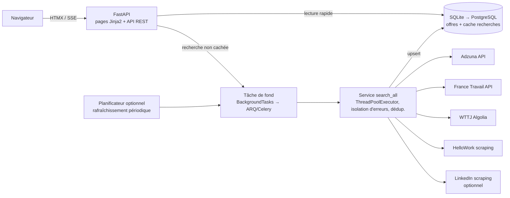

# JobScraper — Passage en version web : diagnostic et propositions

> Analyse réalisée le 18 octobre 2026 sur l'état du dépôt (commit `0bb9fa3`).
> Objectif : rendre l'agrégateur accessible via le web en réutilisant au maximum l'existant.

---

## 1. Diagnostic de l'existant

Le projet actuel est une **CLI Python** (Click + Rich) d'environ 2 950 lignes, structurée en package propre (`src/jobscraper/`).

### ✅ Atouts (ce qui facilite grandement le passage web)

| Élément | Pourquoi c'est un atout pour le web |
|---|---|
| Modèles **Pydantic v2** (`JobOffer`, `SearchCriteria`, enums) | Réutilisables tels quels comme schémas d'API (FastAPI les consomme nativement) et pour la validation des formulaires |
| `BaseScraper` + interface uniforme `search(criteria) -> Iterator[JobOffer]` | Les scrapers sont des **générateurs** : parfait pour afficher les résultats **progressivement** dans le navigateur (streaming SSE) au lieu d'attendre la fin |
| Séparation nette `models / scrapers / config / utils` | La logique métier est déjà découplée de l'affichage… sauf l'orchestration (voir freins) |
| WTTJ via API Algolia, Adzuna via API officielle | 2 sources sur 5 ne dépendent pas du parsing HTML : rapides et robustes |
| Déduplication intra-source, retries (`tenacity`), logs (`loguru`) | Bonnes bases de robustesse |

### ⚠️ Freins à traiter avant (ou pendant) la migration

| Frein | Détail constaté dans le code |
|---|---|
| **Tout est synchrone et séquentiel** | `requests` + `time.sleep(1 à 2 s)` entre chaque page, sources interrogées **l'une après l'autre** dans `cli.py`. Une recherche sur 5 sources peut prendre **30 s à plusieurs minutes** — incompatible avec une requête HTTP classique (timeout navigateur/proxy ~30-60 s) |
| **Aucune couche service** | L'orchestration est codée en 5 blocs quasi identiques dans `cli.py` (lignes 160-220). Sans refactor, il faudrait la dupliquer dans le code web |
| **Aucune persistance ni cache** | Chaque recherche rescrape tout, aucun historique, pas de déduplication **entre** sources (la même offre HelloWork/Adzuna/LinkedIn apparaît plusieurs fois) |
| **Fragilité en chaîne** | Aucun `try/except` dans `cli.py` autour des scrapers : une source qui plante peut faire échouer toute la recherche |
| `AsyncBaseScraper` mort | Défini dans `base.py` mais jamais implémenté par les scrapers — à ignorer ou supprimer, ne pas baser l'architecture dessus |
| **Hygiène du dépôt** | Ni `.gitignore` ni `.env.example` (pourtant promis par le README), aucun test (`tests/` vide), clés Adzuna lues hors de l'objet `Config`, clé Algolia WTTJ en dur dans `wttj.py` |

---

## 2. Le point critique à comprendre avant de choisir une solution

**On ne peut pas simplement "brancher une page web sur la CLI".** Le scraping à la demande pose trois problèmes spécifiques au web :

1. **Latence** — Un visiteur ne peut pas attendre 1 à 3 minutes devant un spinner pendant que le serveur scrape 5 sites page par page. Deux parades, combinables :
   - **Paralléliser les sources** (elles sont indépendantes) : un `ThreadPoolExecutor` suffit, les scrapers étant limités par le réseau, pas le CPU → latence divisée par ~5 sans réécrire le code en async.
   - **Séparer collecte et consultation** : les offres sont collectées en arrière-plan (à la demande mais en tâche de fond, ou planifié toutes les X heures), stockées en base, et le site ne fait que **lire la base** (réponse en < 100 ms, cache des recherches identiques).

2. **Blocage IP** — En local, vous scrape depuis une IP résidentielle. Hébergé, le serveur aura une **IP de datacenter**, souvent bloquée ou captcha-ïsée (LinkedIn est le plus agressif). À tester dès le 1er déploiement, et prévoir que chaque source puisse être désactivée indépendamment sans casser le site.

3. **Cadre d'usage** — Les CGU de LinkedIn (et dans une moindre mesure HelloWork) interdisent le scraping automatisé ; republier des descriptions intégrales pose aussi des questions de droit des bases de données. Bonne pratique pour une version publique : privilégier les **APIs officielles** quand elles existent (voir §6), afficher des extraits avec **lien vers l'offre source**, respecter délais et `robots.txt`. Un usage personnel/démo n'expose évidemment pas au même niveau de risque qu'un service public monétisé — **c'est la première question à trancher (§9)**.

---

## 3. Socle commun de refactorisation (nécessaire quelle que soit l'option)

Estimé à **0,5 à 1,5 jour**. La CLI continue de fonctionner après chaque étape.

1. **Hygiène** : `.gitignore`, `.env.example` *(créés le 18/10/2026)*, déplacer les clés Adzuna/Algolia dans la config (`pydantic-settings`).
2. **Couche service** `src/jobscraper/services/search.py` : un registre `{nom: classe}` de scrapers, une fonction `search_all(criteria, sources)` qui **parallélise** via `ThreadPoolExecutor`, **isole les erreurs par source** (une source en échec = warning, pas un crash) et **déduplique entre sources** (hash titre+entreprise+ville normalisés). `cli.py` devient un simple client de ce service.
3. **Persistance** : SQLite au départ (zéro infra) via SQLModel/SQLAlchemy ; PostgreSQL plus tard si besoin. Table `jobs` + cache de recherches avec TTL (ex. 3 h).
4. **Quelques tests de parsers** sur fixtures HTML avant de toucher aux scrapers (actuellement : aucun filet de sécurité).

---

## 4. Les options pour la partie web

### Option A — Prototype 100 % Python : Streamlit ou NiceGUI

L'interface est écrite en Python pur, dans le même dépôt, en important directement vos modèles et scrapers.

- ⏱️ **Effort : 0,5 à 1 jour** pour un écran de recherche + résultats
- ✅ Aucun JavaScript, aucun framework web à apprendre ; déploiement gratuit (Hugging Face Spaces, Streamlit Cloud)
- ✅ `st.write_stream` / équivalent exploite vos générateurs : résultats affichés au fil de l'eau
- ❌ Rendu et UX limités, mauvais SEO, sessions lourdes (un processus par visiteur), difficile d'ajouter comptes/alertes proprement
- 👉 **Idéal pour** : valider l'idée, démo/portfolio, usage personnel ou petit cercle

### Option B — FastAPI + HTMX ⭐ *(recommandée pour un vrai produit en restant en Python)*

**FastAPI** expose une API REST (vos modèles Pydantic deviennent les schémas d'entrée/sortie, documentation Swagger gratuite). Les pages sont rendues côté serveur (Jinja2) et **HTMX** apporte l'interactivité (recherche sans rechargement, résultats en streaming SSE) **sans écrire de JavaScript applicatif**.

- ⏱️ **Effort : 3 à 6 jours** pour un MVP propre (recherche, filtres reprenant ceux de la CLI, page détail, exports JSON/CSV)
- ✅ Réutilisation maximale : modèles, scrapers, config, logs inchangés ; scrapers synchrones exécutés dans un pool de threads ou en tâche de fond (`BackgroundTasks`, puis ARQ/Celery si le trafic grandit)
- ✅ Bon SEO (HTML rendu serveur), léger, un seul langage, un seul déploiement Docker
- ✅ L'API REST reste exploitable plus tard par une appli mobile ou un front JS
- ❌ Demande d'apprendre FastAPI + notions HTMX (courbe douce pour un profil Python)
- 👉 **Idéal pour** : produit public durable, maintenu par un développeur Python

### Option C — FastAPI (API) + front JavaScript séparé (Vue / React / Next.js)

Même backend que B, mais interface en SPA/SSR JavaScript.

- ⏱️ **Effort : 1 à 3 semaines** selon expérience JS
- ✅ UX la plus riche (filtres instantanés, carte, favoris temps réel…), écosystème énorme, Next.js = excellent SEO
- ❌ Deux codebases, deux déploiements, CORS/auth à gérer, surdimensionné si vous êtes seul et plutôt Python
- 👉 **Idéal pour** : ambition produit forte et compétences (ou envie d'apprendre) le JS moderne

### Option D — Site statique + collecte planifiée

Un job planifié (GitHub Actions en cron, ou cron sur VPS) lance la CLI sur des recherches prédéfinies, génère un JSON, et un site statique (Astro/Hugo) est republié. Hébergement gratuit (GitHub Pages / Cloudflare Pages).

- ⏱️ **Effort : 1 à 2 jours**
- ✅ Coût ~0 €, sécurité et performance imbattables (aucun serveur applicatif exposé), scraping découplé du trafic
- ❌ Pas de recherche libre : l'internaute filtre parmi les offres déjà collectées ; fraîcheur = fréquence du cron
- 👉 **Idéal pour** : vitrine thématique (« les offres data à Nantes »), veille personnelle publiée

> **Variante Django** : si la V1 exige comptes utilisateurs, alertes e-mail et back-office d'administration, Django les fournit d'usine (auth, ORM, admin) contre une réécriture plus lourde et la coexistence de deux systèmes de modèles (Pydantic + Django). FastAPI le peut aussi, en assemblant les briques (SQLAlchemy + FastAPI-Users…). À ne choisir que si ces fonctions sont centrales dès le départ.

---

## 5. Tableau comparatif

| Critère | A. Streamlit/NiceGUI | B. FastAPI + HTMX ⭐ | C. FastAPI + Vue/React | D. Statique planifié |
|---|---|---|---|---|
| Effort MVP | 0,5-1 j | 3-6 j | 1-3 sem. | 1-2 j |
| Compétences requises | Python seul | Python + HTML/CSS | Python + JS moderne | Python + générateur statique |
| Réutilisation du code actuel | ★★★★★ | ★★★★★ | ★★★★ (back) | ★★★★★ (CLI telle quelle) |
| Recherche libre par l'utilisateur | Oui (lente) | Oui (async + cache) | Oui (async + cache) | Non (filtres sur stock) |
| SEO / partage social | Faible | Bon | Excellent (SSR) | Excellent |
| Évolutivité (comptes, alertes) | Faible | Bonne | Excellente | Faible |
| Coût d'hébergement | 0 € (offres gratuites) | 0-7 €/mois | 0-12 €/mois | 0 € |
| Robustesse face aux blocages IP | Faible (scraping live) | Bonne (cache + fond) | Bonne (cache + fond) | Excellente (découplé) |

**Recommandation par défaut : Option B**, précédée du socle commun (§3). L'Option A peut servir d'étape jetable de validation en 1 jour avant d'engager B. L'Option D est la plus pertinente si le budget doit rester à 0 € et le périmètre de recherche est connu à l'avance.

---

## 6. Architecture cible (Option B)



Principes :

- `POST /recherches` (corps = `SearchCriteria` existant) → répond immédiatement avec les résultats **cachés** s'ils sont frais, sinon lance la collecte en fond et **streame** les offres source par source via SSE (vos générateurs s'y prêtent naturellement).
- La CLI et le web appellent le **même service** ; rien n'est jeté.
- Chaque source est indépendante : échec ou blocage = badge « source indisponible » dans l'UI, le reste fonctionne.
- Arborescence ajoutée, sans toucher à l'existante :

```
src/jobscraper/
├── services/search.py        # nouveau : orchestration partagée CLI + web
├── storage/                  # nouveau : modèles BDD + repository + cache
└── web/                      # nouveau : app FastAPI, routes, templates, static
Dockerfile + docker-compose.yml
```

### Stratégie par source (important pour la fiabilité en hébergement)

| Source | Aujourd'hui | Cible web |
|---|---|---|
| **France Travail** | Scraping HTML | ✅ **API officielle** `francetravail.io` (OAuth2, gratuite sur inscription) — réécriture du scraper en client API, bien plus stable et légitime |
| **Adzuna** | API officielle | ✅ Conserver (ajouter ses clés à `Config`) |
| **WTTJ** | API Algolia (clés publiques du front) | ✅ Conserver, externaliser les clés en config |
| **HelloWork** | Scraping HTML | ⚠️ Conserver avec cache agressif ; surveiller les 403 depuis IP datacenter |
| **LinkedIn** | Scraping HTML | 🔴 Le plus risqué (CGU + blocages IP datacenter fréquents) : le rendre **optionnel/désactivable**, ne pas en faire un pilier de la version publique |

---

## 7. Hébergement (à titre indicatif)

| Solution | Coût | Adapté ? |
|---|---|---|
| Hugging Face Spaces / Streamlit Cloud | Gratuit | Option A uniquement, démo |
| Render / Railway / Fly.io | Gratuit limité → ~5-7 €/mois | Options B/C en démarrage ; attention aux cold starts des offres gratuites |
| **VPS** (Hetzner ~4-5 €, OVH / Scaleway ~5-8 €) + Docker Compose | ~5-8 €/mois | ✅ Le plus de contrôle (cron de collecte, BDD, logs), hébergeurs FR disponibles ; demande un minimum d'administration (HTTPS via Caddy/Traefik = simple) |
| Serverless type Vercel/Netlify Functions | Gratuit → variable | ❌ Timeouts courts incompatibles avec le scraping ; ok pour un front seul (Option C/D), pas pour le backend de collecte |

Dans tous les cas : conteneuriser dès le MVP (`Dockerfile`), la migration d'hébergeur devient triviale.

---

## 8. Roadmap proposée

| Phase | Contenu | Durée estimée |
|---|---|---|
| **0. Socle** | Hygiène config, couche service parallélisée + dédup inter-sources, tests parsers minimaux, CLI inchangée visiblement | 0,5-1,5 j |
| **1. MVP web** | FastAPI + HTMX : formulaire (reprendre les filtres CLI), résultats streamés, cache SQLite, page détail avec lien source, exports JSON/CSV | 3-6 j |
| **2. Fiabilisation** | France Travail via API officielle, test de blocage IP sur l'hébergeur choisi, collecte planifiée, gestion d'erreurs par source dans l'UI | 2-4 j |
| **3. Mise en ligne** | Docker, domaine + HTTPS, rate limiting, logs/monitoring, mentions légales et attribution des sources | 1-2 j |
| **4. (Optionnel)** | Comptes, favoris, alertes e-mail sur recherches sauvegardées, carte des offres (vous avez déjà le géocodage !) | selon périmètre |

---

## 9. Décision retenue et réalisation (18 octobre 2026)

Réponses du porteur de projet : **usage personnel**, **FastAPI + front JavaScript (Option C)**,
**hébergement gratuit**, **V1 = recherche + consultation**. Conséquences concrètes :

- Pas de comptes, pas de SEO critique → pas de SSR ; un front compilé servi par FastAPI suffit.
- Budget 0 € → **une seule application Docker** (front + API) déployable sur les offres gratuites
  (Hugging Face Spaces en Docker, Render…), port configurable via `PORT` (7860 par défaut dans l'image).
- Persistance non indispensable en V1 personnelle → simple **cache mémoire** (TTL 15 min,
  `JOBSCRAPER_CACHE_TTL`) ; SQLite/PostgreSQL restent des évolutions possibles.

> **Vue → React** : le front a été écrit en **React** plutôt que Vue, le registre npm accessible
> depuis l'environnement de build renvoyant une erreur 404 sur le paquet `Vue`. L'API étant
> indépendante du framework, un retour à Vue resterait une réécriture limitée du dossier `frontend/`.

### Réalisé

| Brique | Emplacement |
|---|---|
| Couche service : parallélisme par threads, isolation d'erreurs, déduplication inter-sources, cache | `src/jobscraper/services/search.py` |
| CLI rebranchée sur le service (même commande, plus rapide) | `src/jobscraper/cli.py` |
| API FastAPI : `POST /api/search`, streaming SSE `GET /api/search/stream`, `/api/sources`, `/api/health`, doc `/docs` | `src/jobscraper/web/` |
| Front React : formulaire (filtres de la CLI), états par source en direct, cartes d'offres | `frontend/` |
| Source de démonstration sans réseau (`JOBSCRAPER_DEMO=1`) | `src/jobscraper/scrapers/demo.py` |
| Images et lancement | `Dockerfile`, `docker-compose.yml` |
| Tests service + API (scrapers doublés, sans réseau) | `tests/` — 10 tests |

### Prochaines étapes suggérées

1. **Déployer l'image Docker** (Hugging Face Spaces ou Render) et vérifier quelles sources
   répondent depuis une IP datacenter — LinkedIn est le candidat le plus probable au blocage.
2. **Créer les clés Adzuna** (gratuites) et les renseigner dans les variables d'environnement de l'hôte.
3. **Basculer France Travail sur l'API officielle** `francetravail.io` (OAuth2 gratuit) à la place du scraping HTML.
4. Si l'usage s'intensifie : persistance SQLite des offres collectées + rafraîchissement planifié
   (les pages ne dépendraient plus du scraping en direct), puis favoris en localStorage côté navigateur.
